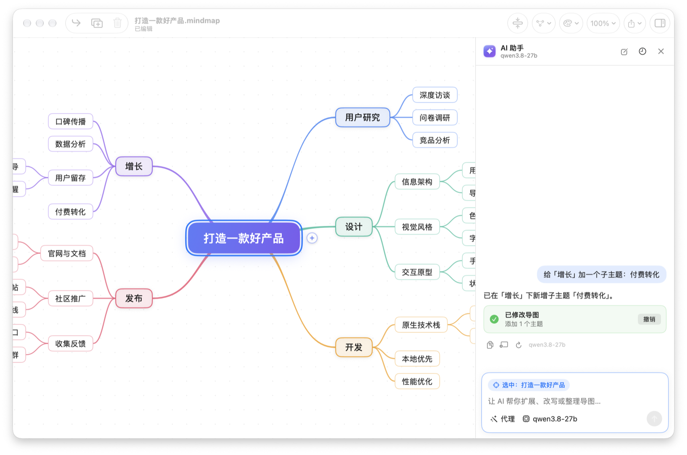

<div align="center">


# MindFlow

**原生 · 美观 · 轻量的 macOS 思维导图，内置 AI 助手**

想法如流水，落笔即成图。

[](https://github.com/245678000000/MindFlow/releases/latest)
[](https://github.com/245678000000/MindFlow/releases)


[](LICENSE)

<br>

<a href="https://github.com/245678000000/MindFlow/releases/latest">
  
</a>

<sub>Universal 二进制 · Apple 芯片与 Intel 通用 · 不到 2 MB</sub>

<br><br>


</div>

<br>

## ✨ 为什么是 MindFlow

<table>
<tr>
<td width="33%" valign="top">

### 🍃 轻
纯 SwiftUI + AppKit，零第三方依赖。秒开，安装包不到 2 MB，除 AI 与检查更新外从不联网。

</td>
<td width="33%" valign="top">

### 🎨 美
锥形渐变主干、柔和贝塞尔分支、点阵画布，5 套精心调配的主题，自动适配浅色 / 深色模式。

</td>
<td width="33%" valign="top">

### ⚡️ 快
键盘优先：一个 `Tab` 一个想法。也可以点选中主题旁的 **＋**，拖拽节点改换父级。

</td>
</tr>
</table>

<br>

## 🤖 AI 助手



按 <kbd>⌘</kbd> <kbd>J</kbd> 打开侧边栏，用一句话改导图。

| | |
|---|---|
| **代理模式** | AI 直接动手：扩展分支、改写措辞、调整结构，或从零生成整张图。每次修改都能**一键撤销** |
| **问答模式** | 只聊不改。回答里的列表可一键插入到选中的主题下 |
| **接口** | Anthropic Messages · OpenAI Chat Completions · OpenAI Responses，以及各类兼容服务，流式输出 |
| **一键导入** | 从本机的 **cc-switch**、**magpie** 读取服务商配置，或从文件导入，全程本地完成 |

> [!NOTE]
> API Key 只保存在本机 `~/Library/Application Support/MindFlow/providers.json`（权限 `600`），请求直接发往你配置的服务商，MindFlow 不经手任何数据。

<br>

## 🧩 功能一览

- **两种布局**：平衡（左右分布）/ 向右展开
- **原生文档**：`.mindmap`（JSON）格式，支持撤销重做、自动保存、版本历史、多窗口与标签页
- **导出**：PNG 高清图（2×）· **XMind**（兼容 XMind 2020+ 与 XMind 8）· Markdown · 文本大纲
- **手势**：双指平移，捏合或 <kbd>⌘</kbd> + 滚轮缩放，一键适应窗口
- **自动更新**：基于 GitHub Releases，有新版本时一键下载、替换、重启

<br>

## ⌨️ 快捷键

<table>
<tr><th>编辑</th><th></th><th>视图</th><th></th></tr>
<tr><td><kbd>Tab</kbd></td><td>添加子主题</td><td><kbd>⌘</kbd> <kbd>=</kbd> / <kbd>⌘</kbd> <kbd>-</kbd></td><td>放大 / 缩小</td></tr>
<tr><td><kbd>Return</kbd></td><td>添加同级主题</td><td><kbd>⌘</kbd> <kbd>0</kbd></td><td>实际大小</td></tr>
<tr><td><kbd>Space</kbd></td><td>编辑文字</td><td><kbd>⌘</kbd> <kbd>9</kbd></td><td>适应窗口</td></tr>
<tr><td><kbd>⌫</kbd></td><td>删除主题</td><td><kbd>⌘</kbd> <kbd>J</kbd></td><td>AI 助手</td></tr>
<tr><td><kbd>/</kbd></td><td>折叠 / 展开</td><td><kbd>⇧</kbd> <kbd>⌘</kbd> <kbd>E</kbd></td><td>导出图片</td></tr>
<tr><td><kbd>←</kbd> <kbd>↑</kbd> <kbd>↓</kbd> <kbd>→</kbd></td><td>在主题间移动</td><td><kbd>Esc</kbd></td><td>取消编辑</td></tr>
</table>

<br>

## 📦 安装

1. 从 [**Releases**](https://github.com/245678000000/MindFlow/releases/latest) 下载 `MindFlow-x.y.z.zip`
2. 解压，把 **MindFlow.app** 拖进「应用程序」
3. 首次打开如提示「无法验证开发者」，右键 → **打开** 即可；或执行：

```sh
xattr -dr com.apple.quarantine /Applications/MindFlow.app
```

<br>

## 🛠 从源码构建

只需 macOS 14+ 与 Xcode Command Line Tools，**不需要完整 Xcode**。

```sh
git clone https://github.com/245678000000/MindFlow.git
cd MindFlow
./build.sh              # 本机架构
./build.sh universal    # Apple 芯片 + Intel 通用二进制
open build/MindFlow.app
```

<details>
<summary><b>发布新版本</b></summary>

```sh
scripts/release.sh 1.1.0 "更新说明"
```

会自动写入版本号、构建通用二进制、打包 zip、打 tag 并创建 GitHub Release，已安装的 App 会在下次检查时收到更新。

</details>

<details>
<summary><b>项目结构</b></summary>

```
Sources/MindFlow/
├── App.swift              # 场景与菜单命令
├── Model.swift            # 文档模型（.mindmap）
├── Layout.swift           # 自动布局引擎
├── MapCanvas.swift        # 画布、节点与连线绘制
├── MindMapView.swift      # 主窗口与工具栏
├── MapViewModel.swift     # 编辑、导航、缩放、导出
├── XMindExporter.swift    # XMind 导出（内置 ZIP 写入）
├── Updater.swift          # 检查更新
└── AI/                    # 侧边栏、LLM 客户端、导图代理、服务商导入
```

</details>

<br>

## 📄 许可

[MIT](LICENSE) © 2026 245678000000

<div align="center">
<sub>用 ❤️ 和 SwiftUI 打造</sub>
</div>
