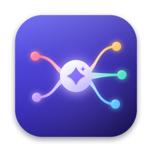
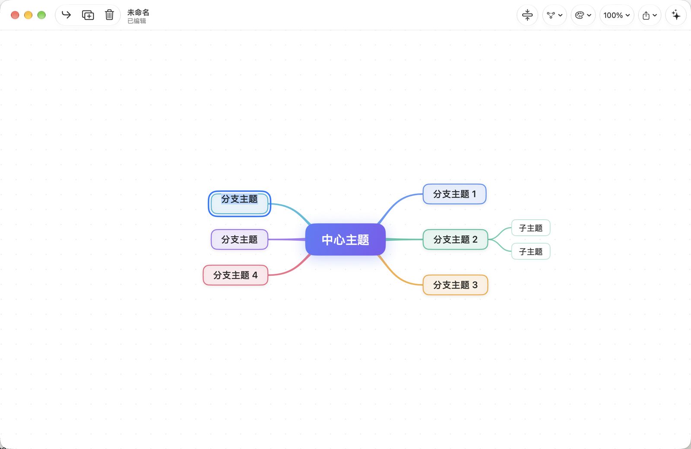

<p align="center">
  
</p>

<h1 align="center">MindFlow</h1>

<p align="center">原生、美观、轻量的 macOS 思维导图，内置 AI 助手。</p>

<p align="center">
  
</p>

## 特性

- **纯原生**：SwiftUI + AppKit 编写，无第三方依赖，App 体积不到 2 MB
- **好看**：锥形渐变主干、柔和曲线分支、5 套配色，自动跟随浅色/深色模式
- **键盘优先**：`Tab` 子主题、`Return` 同级、`Space` 编辑、方向键移动、`⌫` 删除、`/` 折叠
- **顺手的鼠标操作**：选中主题旁的 ➕ 一键加子主题；拖动节点改变父级；双指平移、捏合或 `⌘` + 滚轮缩放
- **两种布局**：平衡（左右分布）与向右
- **原生文档**：`.mindmap`（JSON），支持撤销/重做、自动保存、版本历史、多窗口与标签页
- **导出**：PNG 图片（2×）、XMind（兼容 XMind 2020+ 与 XMind 8）、Markdown、文本大纲

## AI 助手

按 `⌘J` 打开侧边栏。

- **代理模式**：AI 直接修改导图——扩展、改写、移动、删除，或从零生成整张图；每次修改都可一键撤销
- **问答模式**：只回答问题；回答中的列表可一键插入到选中主题下
- 支持 **Anthropic Messages**、**OpenAI Chat Completions**、**OpenAI Responses** 三种接口及各类兼容服务，流式输出
- 可从本机的 **cc-switch**、**magpie** 一键导入服务商配置，也可从文件导入；读取只在本地进行

> API Key 保存在 `~/Library/Application Support/MindFlow/providers.json`（权限 600），不会上传到任何地方。

## 构建

需要 macOS 14+ 与 Xcode Command Line Tools（无需完整 Xcode）。

```sh
./build.sh
open build/MindFlow.app
```

App 使用本地 ad-hoc 签名。首次在其他 Mac 上打开时，请右键 → 打开。

## 快捷键

| 操作 | 快捷键 |
| --- | --- |
| 添加子主题 / 同级主题 | `Tab` / `Return` |
| 编辑文字 | `Space` 或双击 |
| 删除 / 折叠 | `⌫` / `/` |
| 选择相邻主题 | 方向键 |
| 缩放 | `⌘=` / `⌘-` / `⌘0`，或 `⌘` + 滚轮 |
| 适应窗口 | `⌘9` 或双击空白处 |
| AI 助手 | `⌘J` |
| 导出图片 | `⇧⌘E` |

## 许可

[MIT](LICENSE)
